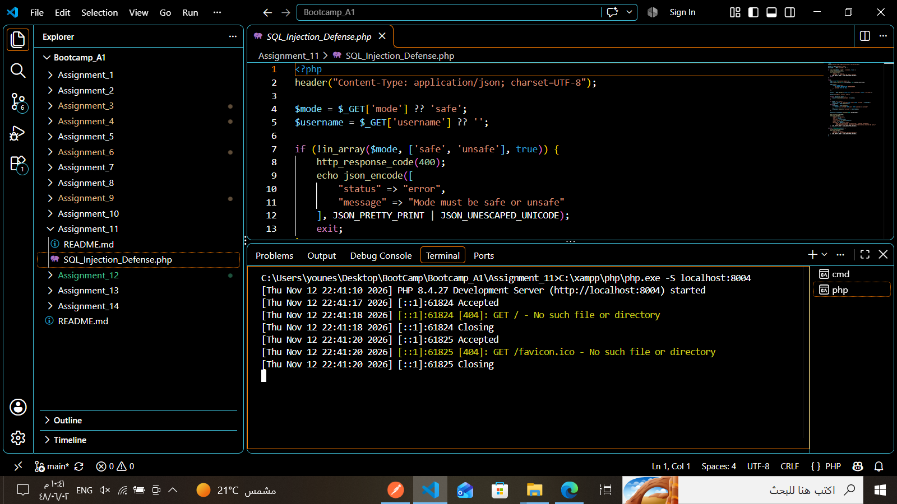

# 🛡️ SQL Injection Defense Lab (`sqli-defense-lab`)

**Author:** Younes Al-Salami  
**Domain:** Application Security (AppSec) / Secure Coding  
**Language:** PHP (PDO & In-Memory SQLite)  
**Main File:** `SQL_Injection_Defense.php`

---

## 📖 Overview

An interactive security lab demonstrating the mechanics of **SQL Injection (SQLi)** vulnerabilities caused by unsafe string concatenation versus effective mitigation using **PDO Prepared Statements**.

The lab runs on a self-contained **SQLite in-memory database**, requiring zero external database setup, making it ideal for cybersecurity learners, developers, and security demonstrations.

---

## ✨ Key Features

- **Zero-Config Database:** Automatically initializes an ephemeral SQLite in-memory database and seeds sample user records (`younes`, `admin`, `alice`, `bob`).
- **Dual Execution Modes:**
  - **❌ Unsafe Mode:** Directly concatenates user input into the SQL query string, exposing the application to SQL injection.
  - **✅ Safe Mode:** Uses parameterized queries (`PDO::prepare()` and `execute()`), enforcing strict separation between SQL code and user data.
- **Secure Error Handling:** Catches `PDOException` gracefully without leaking sensitive database schemas or stack traces.

---

## 📂 Project Structure

```text
sqli-defense-lab/
├── SQL_Injection_Defense.php      # Core application logic and UI
├── SQL_Injection_Defense.png      # Main interface screenshot
├── unsafe mode.png                # Screenshot showing successful SQLi bypass
├── Safe Mode.png                  # Screenshot of safe mode standard lookup
├── safe mode (2).png              # Additional safe mode verification
├── safe mode with OR 1=1.png      # Screenshot showing blocked SQLi payload
└── README.md                      # Project documentation
```

---

## ⚙️ Requirements

- **PHP 7.4+** or **PHP 8.x**
- **PDO Extension** with the **`pdo_sqlite`** driver enabled
- PHP built-in development server or a local stack (XAMPP / Laragon / WAMP)

---

## 🚀 Installation & Usage

### 1. Clone the Repository

```bash
git clone https://github.com
cd sqli-defense-lab
```

### 2. Verify `pdo_sqlite` Driver

Ensure the SQLite PDO driver is enabled in your PHP environment:

```powershell
# Windows (XAMPP example)
C:\xampp\php\php.exe -m | findstr pdo_sqlite

# Linux / macOS
php -m | grep pdo_sqlite
```

*(If missing, open `php.ini` and uncomment `;extension=pdo_sqlite` by removing the semicolon, then restart your terminal/server).*

### 3. Start the Local Server

Run the built-in PHP server inside the project directory:

```powershell
# Windows (XAMPP example)
C:\xampp\php\php.exe -S localhost:8004

# Standard PHP CLI
php -S localhost:8004
```

### 4. Access the Lab

Open your browser and navigate to:

```text
http://localhost:8004/SQL_Injection_Defense.php
```

---

## 🧪 Demonstration & Test Cases

Use the classic authentication bypass payload below to observe the difference in behavior:

```sql
' OR '1'='1
```

### Recommended Test Matrix

| Mode | Input Payload | Expected Behavior | Security Outcome |
| :--- | :--- | :--- | :--- |
| **Safe Mode** | `alice` | Returns only the single matching record for `alice`. | Normal behavior |
| **Unsafe Mode** | `' OR '1'='1` | Alters the SQL `WHERE` clause to always evaluate to `TRUE`, exposing all users. | **Vulnerable (SQLi)** |
| **Safe Mode** | `' OR '1'='1` | Treats the entire payload as a literal username string; returns 0 records. | **Protected** |

---

## 📸 Screenshots

### Main Lab Interface



### Side-by-Side Exploitation Comparison (`' OR '1'='1`)

| ❌ Unsafe Mode (Concatenation) | ✅ Safe Mode (PDO Prepared Statement) |
| :--- | :--- |
|  |  |
| *The injected payload manipulates query logic and exposes all database rows.* | *The payload is parameterized as plain text, neutralizing the attack.* |

### Standard Safe Mode Execution


### Additional Safe Mode Verification

.png)

---

## 🛡️ Security Takeaway

Never trust user-supplied input. String concatenation in SQL queries allows attackers to break out of the data context and inject arbitrary SQL commands. Always use **Parameterized Queries (Prepared Statements)** so the database engine compiles the SQL structure before inserting user parameters.

---

## ⚠️ Disclaimer

This tool is developed strictly for **educational purposes and authorized security training**. Do not test SQL injection techniques on systems without explicit permission.
